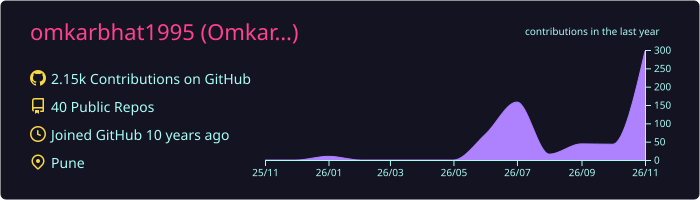
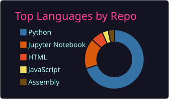
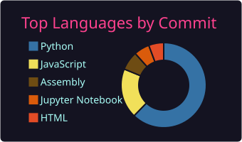

# Hi there, I'm [Omkar Bhat](https://about.me/omkarbhat/) 👋

**Data Scientist, ML Engineer & Systems Architect | Dual M.S., UVA**  
I build end-to-end machine learning models, interactive BI dashboards, and the scalable data pipelines required to deploy them. With a dual background in Computer Science and Systems Engineering, I bridge the gap between predictive algorithms, NLP/deep learning, and production infrastructure.

Currently a **Data Science Intern at NexGen Analytix** in Pune, I focus on large-scale data engineering, Python ML pipelines, and relational database architecture to drive business decision-making.

---

## 📑 Table of Contents
- [Technical Arsenal](#technical-arsenal)
- [Professional Experience](#professional-experience)
- [Featured Machine Learning & AI Projects](#featured-machine-learning--ai-projects)
- [Data Engineering & BI Analytics](#data-engineering--bi-analytics)
- [Systems Architecture & Security Research](#systems-architecture--security-research)
- [Education & Certifications](#education--certifications)
- [Academic Research & Publications](#academic-research--publications)
- [Let's Connect](#lets-connect)

---

## 🛠️ Technical Arsenal

**Languages & Querying**

  
  
  
  
  
  

 

**Machine Learning, NLP & Big Data**

  
  
  
  
  
  
  

 

**Cloud, DevOps & Databases**

  
  
  
  
  
  
  
  

 

**Business Intelligence & Analytics**

  
  
  

 

- **Data Science & AI:** Python, Scikit-Learn, XGBoost, PyTorch (RNNs, LSTMs, ST-GCNs), Hugging Face, NLTK, Pandas, PySpark
- **BI & Visualization:** Power BI (DAX, Power Query), Tableau, Advanced Excel, Streamlit
- **Systems, MLOps & Databases:** AWS (EC2), Docker, Terraform, FastAPI, MySQL, SQLite, MongoDB, pytest

---

## 💼 Professional Experience

* **Data Science Intern | NexGen Analytix** *(June 2026 – Present)*
  Building end-to-end data pipelines, predictive analytics models, and complex SQL workflows in Python to support enterprise decision-making.
* **Graduate Research Orchestrator (DARPA PCORE) | University of Virginia** *(2019 – 2022)*
  Architected sandboxed C/C++ network replicas and generated a 3TB+ network telemetry dataset using Python, Pandas, Docker, and AWS to evaluate host identification under adversarial conditions.
* **Network Software Intern | Prelude Netcomms** *(Dec 2017 – June 2018)*
  Optimized network workflows by analyzing enterprise packet metrics, reducing system downtime by 10%.

---

## 🤖 Featured Machine Learning & AI Projects

➤ **[SentinelGraph: Financial Fraud Triage & Compliance Multi-Agent System](https://github.com/omkarbhat1995/SentinelGraph-Financial-Fraud-Triage-Compliance-Multi-Agent-System)**  
  Architected a stateful multi-agent workflow using **LangGraph** and Python to automate suspicious transaction triage, compliance rule verification, and structured audit trail generation.
➤ **[Customer Churn Prediction Pipeline & FastAPI Service](https://github.com/omkarbhat1995/Customer-Churn-Prediction-Pipeline)**  
  Engineered an end-to-end classification pipeline (Logistic Regression & Decision Trees) trained on a 1M-row customer dataset, complete with automated preprocessing and a real-time FastAPI inference microservice.
➤ **[Multi-Ticker Stock Price Regression & Streamlit Dashboard](https://github.com/omkarbhat1995/Stock-Price-Regression)** *(verify exact repo slug)*  
  Built a modular regression pipeline (Linear, Polynomial, and Decision Tree models) trained across ~1,000 historical equity CSVs, paired with an interactive Streamlit app for trend visualization and model benchmarking.
➤ **[Airline Fare Prediction Pipeline (`Airline_ML`)](https://github.com/omkarbhat1995/Airline_ML)**  
  Developed a production-structured machine learning workflow featuring automated feature engineering, cross-validated regression tuning, and modular inference scripts for dynamic flight pricing.
➤ **[AI Supply Chain Control Tower](https://github.com/omkarbhat1995/AI-Supply-Chain-Tower)**  
  Combined NLP risk extraction, XGBoost delay regression, Random Forest damage classification, and time-series demand forecasting inside a unified Streamlit command dashboard.
➤ **[Colliding Condition Detection in Smart Cities](https://github.com/omkarbhat1995/Smart-City-Collision-Detection)**  
  Trained PyTorch deep learning models (RNNs and Spatio-Temporal Graph Convolutional Networks) achieving **95% accuracy** in urban event detection; containerized with Docker and provisioned on AWS EC2 via Terraform.
➤ **[Smart City Traffic Forecaster](https://github.com/omkarbhat1995/Smart-City-Forecaster)**  
  Built an interactive Streamlit dashboard powered by XGBoost and lag/cyclical time-series features to forecast urban traffic volume on UCI Metro Interstate data.
---

## 📊 Data Engineering & BI Analytics

* **[Financial Fraud Command Center & Healthcare Operations Dashboards (Power BI)](https://github.com/omkarbhat1995/Hospital-Healthcare-Dashboards)**  
  Designed star-schema data models and interactive Power BI reports featuring custom DAX KPIs, anomaly heatmaps, and drill-through executive views for fraud monitoring and hospital operations.
* **[Enterprise ETL Financial Fraud Pipeline (`PySpark` & `SQLite`)](https://github.com/omkarbhat1995/ETL-Financial-Fraud)**  
  Architected a hybrid PySpark-Pandas ETL pipeline extracting Kaggle financial transaction data via API, executing distributed transformations, and loading partitioned metrics into a local SQLite data warehouse.
* **[Library Management System (`Streamlit` & `MySQL`)](https://github.com/omkarbhat1995/Library-Management-System)**  
  Built a full-stack transactional database application backed by normalized MySQL schemas, stored procedures, and a Streamlit frontend for inventory and circulation analytics.
* **[Automated Sales Analytics & Reporting (`Excel`)](https://github.com/omkarbhat1995/Sales-Data-Analysis-and-Dashboard)**  
  Created dynamic Excel reporting workbooks utilizing Power Query, statistical functions, and interactive PivotTables to automate recurring KPI tracking.

---

## 🛡️ Systems Architecture & Security Research

* **[End-to-End MLOps Network Intrusion Detection API](https://github.com/omkarbhat1995/Network-Intrusion-Detection)**  
  Containerized a Random Forest intrusion classifier and batch PCAP processor using FastAPI, Uvicorn, and Docker for real-time network telemetry scoring.
* **[Synthetic PCAP Traffic Generator (`PyTorch LSTM` & `Scapy`)](https://github.com/omkarbhat1995/Pcap-Generator)**  
  Trained LSTM sequence models on UNB ISCX VPN-nonVPN and LORIA datasets paired with Scapy packet crafting to synthesize realistic encrypted network traffic.
* **[PCORE Malware Replica & Telemetry Architecture](https://github.com/omkarbhat1995/Eomtet-Public)**  
  Built isolated Docker network testbeds to capture and analyze 3TB+ of malware packet telemetry for behavioral host identification.

---

## 🎓 Education & Certifications

* **Master of Science in Systems Engineering** | University of Virginia *(GPA: 3.81)*
* **Master of Computer Science** | University of Virginia *(GPA: 3.80)*
* **Bachelor of Engineering in Information Technology** | Savitribai Phule Pune University *(GPA: 3.75)*
* **Certifications:**
  * Advanced Certification in Data Science & Analytics — *IIT Patna, NASSCOM & FutureSkills Prime (2026)*
  * Veracode Security Labs Champion — *Levels 1, 2 & 3*

---

## 📚 Academic Research & Publications

* **Master's Thesis:** *"On the Repeatability of Metaheuristic Research,"* University of Virginia, 2024. (`DOI: 10.18130/2hjd-h724`)
* **Peer-Reviewed Publications:**
  * *"Introduction to IoT"* (2017) – **350+ academic citations** (`DOI: 10.17148/IJARCCE.2017.61229`)
  * *"Implementation of IoT in Smart Homes"* (2018) (`DOI: 10.17148/IARJSET.2018.517`)
  * *"Applications of IoT and IoT: Vision 2020"* (2018) (`DOI: 10.17148/IARJSET.2018.516`)
  * *"IoT based Counteracting Services for CARDIAC Patients"* (2017) (`DOI: 10.17148/IJARCCE.2017.61228`)

---

## 📫 Let's Connect

  
  
  
  
  

 

  
  
  

